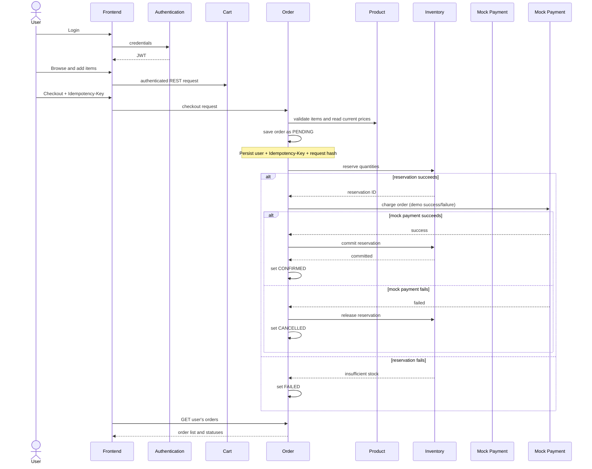

# Checkout Workflow (Target Demo)

## Current state (verified)

The current frontend's `checkout()` in `frontend/index.html` only shows a success message, clears its browser `localStorage` cart, and refreshes the order list; it does not create an order. The separate Quick Buy path posts one product to Order. Current Order checks Product's reported stock but does not change it. The workflow below is the target, not current behavior.

## Synchronous classroom demo flow

## Steps and simple failure handling

1. User logs in; Authentication returns a signed JWT. Frontend sends it with protected calls. Services validate it locally and do not call Authentication per request.
2. User browses Product and edits their Cart. The cart stores product IDs and quantities, not trusted prices.
3. Frontend calls Order checkout with cart/items and an `Idempotency-Key`. Order derives user identity from the JWT, re-reads product details/prices from Product, validates quantities, calculates the total, and saves an order with status `PENDING`, item snapshots, the idempotency key, and a request hash before external side effects.
4. Order asks Inventory to reserve all requested items in one database transaction. `available_quantity` means quantity available for a new reservation: Inventory subtracts the requested quantities as it creates the `HELD` reservation in that same transaction. It conditionally updates only rows with enough quantity, so concurrent requests cannot reserve more than available. If stock is insufficient, the transaction rolls back, Inventory returns `409`, Order records `FAILED`, and Payment is not called.
5. If reservation succeeds, Order calls Mock Payment synchronously with the order ID and server-calculated total. A demo option (for example, a `simulate` value allowed only in local/demo configuration) selects success or failure. No card details are accepted or stored.
6. On mock payment success, Order asks Inventory to commit the reservation. Commit only changes `HELD` to `COMMITTED`; it does not subtract stock again. If Commit succeeds, Order records `CONFIRMED`. If Inventory has a temporary error, Order remains `PENDING`; a retry resumes at Commit and reuses the existing successful mock payment attempt. The user sees the current status through the order list.
7. On payment failure, Order asks Inventory to release the reservation and records `CANCELLED`. If the Inventory release call temporarily fails, leave the order `PENDING`, return a retryable service error, and retry the same idempotent release when the user/operator retries; do not report cancellation as complete until release succeeds.
8. If a service is unavailable, return `503 SERVICE_UNAVAILABLE` with the order ID where one exists. Persisted `PENDING` orders can be retried with the same idempotency key. Before doing work on a retry, Order reads the existing Inventory reservation state and Mock Payment attempt/result. It resumes only the first incomplete step: it does not create another order, reserve the same items again, or create another payment attempt. Inventory reserve is keyed by order ID and Payment attempt by order ID so a repeated call also returns the original result. For this demo, show a clear pending/error state and retry manually; no worker, broker, outbox, or automated saga is required.

## Duplicate requests and reservation expiry

Require `Idempotency-Key` for checkout. Store it with the user, order, and a hash of the normalized request. On a repeated key, Order first compares the request hash: the same request resumes the existing `PENDING` order or returns its terminal result; a different request returns `409 IDEMPOTENCY_KEY_REUSED`. To resume `PENDING`, Order looks up the reservation by order ID and the previous Mock Payment attempt by order ID before issuing calls. If a reservation is already `HELD`, it does not reserve again; if payment is already `SUCCEEDED` or `FAILED`, it does not create another attempt. When payment succeeded but Commit failed temporarily, Order retries only Commit. A unique `(user_id, idempotency_key)` constraint prevents a second Order row.

Inventory reservations have a short configurable expiry. There is no background worker: Inventory checks expiry when Commit is attempted or during a later Inventory operation. When it encounters an expired `HELD` reservation, it marks it `EXPIRED` and restores the reserved amount to `available_quantity` exactly once. Commit must reject `EXPIRED`. If expiry is found before payment, Order records `FAILED` and does not call Payment. If mock payment already succeeded but Commit is rejected due to expiry, this mock has no real funds to refund: Order remains non-confirmed and records `FAILED` with a clear `reservation_expired_after_payment` reason for review. Real refunds are out of scope.

## Order statuses for the demo

Use a small, explainable set: `PENDING` (checkout in progress or waiting on a retry, including successful mock payment awaiting Inventory Commit), `CONFIRMED` (mock payment succeeded and Inventory Commit succeeded), `CANCELLED` (mock payment failed and reservation was released), and `FAILED` (for example, reservation failed or expired). Keep transitions in Order Service and reject invalid changes with `409 ORDER_STATE_CONFLICT`. `GET /orders` is scoped to the authenticated user; an optional admin view may list all orders.
