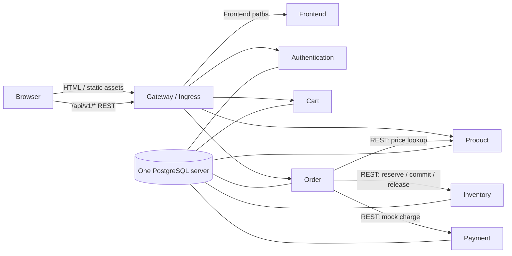

# E-commerce Microservices Demo: Architecture Overview

## Current state (verified from the repository)

This section describes what exists now, not the target design. The repository has a static HTML/CSS/JavaScript frontend served by Nginx, a Node.js/Express Product Service, and a Node.js/Express Order Service. The backend entry points are `product-service/server.js` and `order-service/server.js`.

- Product data and Order records are in process memory; no database is configured.
- Order calls Product over HTTP using Axios to validate product existence and check the product's displayed stock. It does not reserve or decrement stock.
- The browser calls Product and Order directly. Its cart is in browser `localStorage`.
- The frontend's `checkout()` currently displays a success message and clears its browser cart without creating an Order API record. Quick Buy does create a single-item order.
- `docker-compose.yml` and `k8s/` describe the current three components only. No Authentication, Cart, Inventory, or Payment service exists yet.

These are verified repository facts. The rest of this document describes the **proposed target demo**.

## Target architecture (demo)

The demo has exactly seven business services: Frontend, Authentication, Cart, Payment, Inventory, Product, and Order. PostgreSQL, the API Gateway/Ingress, Prometheus, and Grafana are infrastructure and do not add business services.

## Request routing

The gateway routes browser page and asset requests (for example `/` and `/assets/...`) to Frontend. Separately, it proxies `/api/v1/...` requests to the relevant service API. Frontend uses the gateway API path; it does not need internal service addresses or per-service browser ports. Service-to-service REST calls use internal service DNS. The initial local demo can use one gateway configuration; Kubernetes Ingress can provide the same path routing when deployed.

## Authentication and data boundaries

Authentication issues a signed JWT after login. Each protected service verifies the JWT locally with the configured signing secret and checks expiry/claims; it does not call Authentication for every request. For this student demo, a shared `JWT_SECRET` is the simplest setup. It must be configured consistently for the services and kept out of source control. Passwords are stored as hashes, never plaintext.

Use one PostgreSQL server with a separate schema per service (`auth`, `products`, `carts`, `inventory`, `orders`, `payments`). Each service owns and accesses only its schema; other services request data through REST. For a closer ownership boundary, configure a database role per schema. The demo does not require separate PostgreSQL servers.

Product owns catalog and prices; Inventory owns quantities/reservations; Cart owns per-user cart lines; Order owns order state and purchase-time price snapshots; Payment owns mock payment outcomes; Authentication owns users and password hashes. Frontend is presentation only and is not authoritative for prices, stock, payment, or order status.

In Inventory, `available_quantity` is the quantity open for reservation. Reserve subtracts it atomically with reservation creation; Commit finalizes the reservation without subtracting again; Release restores it once. Conditional database updates prevent concurrent over-reservation. Since the demo has no background worker, expiry is detected on Commit or a later Inventory operation.

Checkout uses a user-scoped `Idempotency-Key`. If a request is retried while its Order is `PENDING`, Order checks the saved request, existing Inventory reservation, and Mock Payment attempt/result, then continues from the first incomplete step. A retry must not create another order, reserve the same items twice, or repeat the mock payment. In particular, after mock payment succeeds but Inventory Commit temporarily fails, the order stays `PENDING` until a retry successfully commits; only then is it `CONFIRMED`.

## Demo scope and deferred infrastructure

Use synchronous REST calls and PostgreSQL transactions within the owning service. Mock Payment returns a configurable success or failure and does not collect/store card data. Redis and RabbitMQ are unnecessary for a single-instance classroom demo: PostgreSQL and direct HTTP are enough to demonstrate persistence and service communication. They may be future options for caching or asynchronous messaging if the project later needs those capabilities. Prometheus/Grafana are optional after the core flow works.

See [service responsibilities](services-responsibilities.md), [database design](database-design.md), [checkout workflow](checkout-workflow.md), [decisions](decisions.md), [API contracts](../api-contracts/), and the [roadmap](../implementation-roadmap.md).
