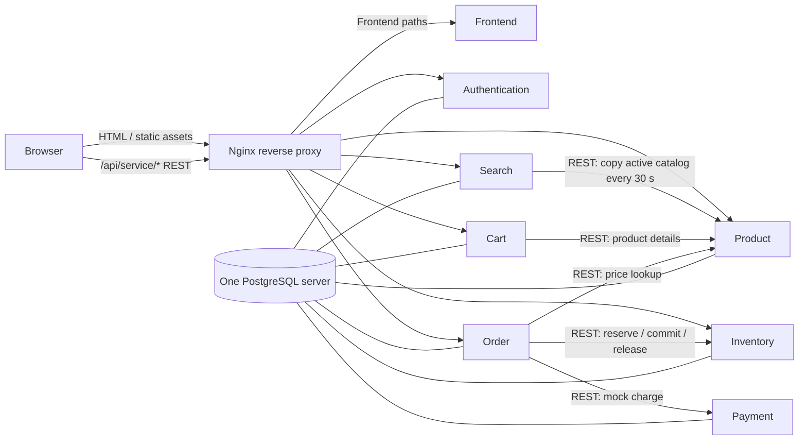

# E-commerce Microservices Demo: Architecture Overview

## Current state

The repository implements eight business services as Node.js/Express services (plus a static HTML/CSS/JavaScript frontend) and runs them with Docker Compose against one PostgreSQL server. Nginx in the frontend container serves the pages and is the reverse proxy for every public API (`/api/<service>/...`); only port 3000 is published to the host. Kubernetes, CI/CD, Terraform, Ansible and monitoring are not implemented yet.

The sections below describe the architecture as implemented.

## Architecture (demo)

The demo has eight business services: Frontend, Authentication, Cart, Payment, Inventory, Product, Order, and Search. PostgreSQL, the API Gateway/Ingress, Prometheus, and Grafana are infrastructure and do not add business services.

## Request routing

Nginx (in the frontend container) serves browser pages and assets (for example `/` and `/admin`). Separately, it proxies `/api/<service>/<path>` to the service, stripping the prefix: `auth`, `product`, `cart`, `inventory`, `order` and `search`. Payment and the internal Inventory reservation routes are not exposed. Frontend uses same-origin `/api/...` paths and never needs internal service addresses or per-service browser ports. Service-to-service REST calls use internal service DNS. Kubernetes Ingress can provide the same path routing when deployed.

## Authentication and data boundaries

Authentication issues a signed JWT after login. Each protected service verifies the JWT locally with the configured signing secret and checks expiry/claims; it does not call Authentication for every request. For this student demo, a shared `JWT_SECRET` is the simplest setup. It must be configured consistently for the services and kept out of source control. Passwords are stored as hashes, never plaintext.

Use one PostgreSQL server with a separate schema per service (`auth`, `products`, `carts`, `inventory`, `orders`, `payments`, `search`). Each service owns and accesses only its schema; other services request data through REST. For a closer ownership boundary, configure a database role per schema. The demo does not require separate PostgreSQL servers.

Product owns catalog and prices; Inventory owns quantities/reservations; Cart owns per-user cart lines; Order owns order state and purchase-time price snapshots; Payment owns mock payment outcomes; Authentication owns users and password hashes; Search owns a read-only search index copied from Product's public API. Frontend is presentation only and is not authoritative for prices, stock, payment, or order status.

In Inventory, `available_quantity` is the quantity open for reservation. Reserve subtracts it atomically with reservation creation; Commit finalizes the reservation without subtracting again; Release restores it once. Conditional database updates prevent concurrent over-reservation. Since the demo has no background worker, expiry is detected on Commit or a later Inventory operation.

Checkout uses a user-scoped `Idempotency-Key`. If a request is retried while its Order is `PENDING`, Order checks the saved request, existing Inventory reservation, and Mock Payment attempt/result, then continues from the first incomplete step. A retry must not create another order, reserve the same items twice, or repeat the mock payment. In particular, after mock payment succeeds but Inventory Commit temporarily fails, the order stays `PENDING` until a retry successfully commits; only then is it `CONFIRMED`.

## Demo scope and deferred infrastructure

Use synchronous REST calls and PostgreSQL transactions within the owning service. Mock Payment returns a configurable success or failure and does not collect/store card data. Redis and RabbitMQ are unnecessary for a single-instance classroom demo: PostgreSQL and direct HTTP are enough to demonstrate persistence and service communication. They may be future options for caching or asynchronous messaging if the project later needs those capabilities. Prometheus/Grafana are optional after the core flow works.

See [service responsibilities](services-responsibilities.md), [database design](database-design.md), [checkout workflow](checkout-workflow.md), [decisions](decisions.md), [API contracts](../api-contracts/), and the [roadmap](../implementation-roadmap.md).
